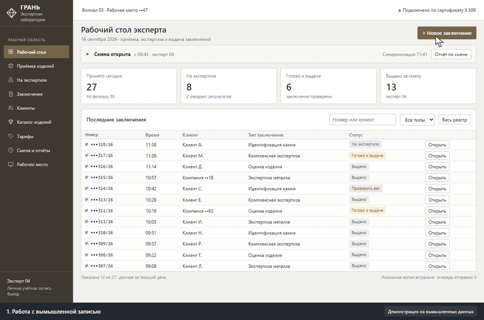
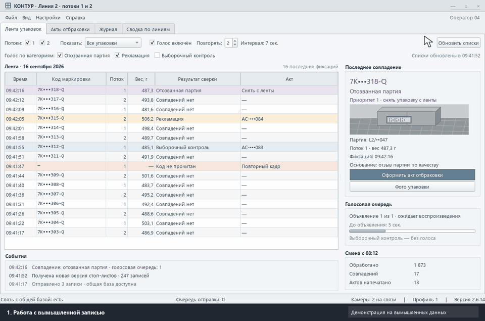
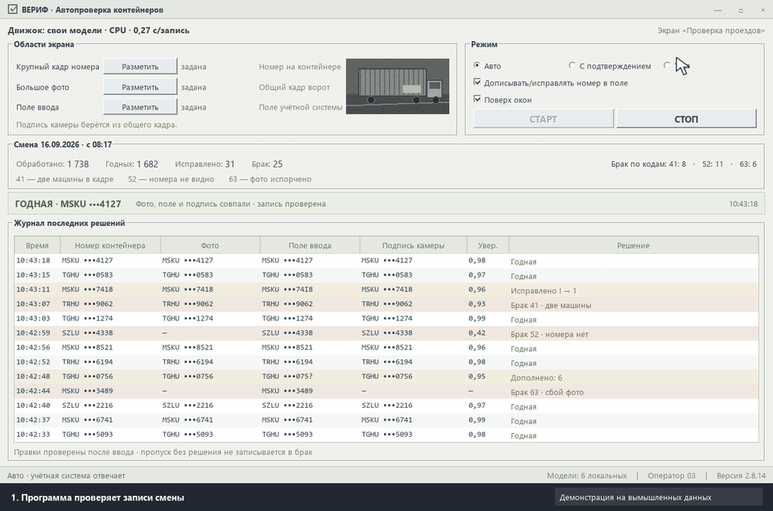

# CRM и программы для бизнеса под ключ

Делаем, внедряем и сопровождаем. Наводим порядок в записи, клиентах, кассе и документах.

## Что мы делаем

- **CRM-системы** — запись и расписание, клиенты, касса и расчёты, отчёты, права сотрудников
- **Учётные системы и документы** — договоры, акты и бланки по шаблонам, нумерация, реестры, печать
- **Сайты и веб-сервисы** — сайты компаний, личные кабинеты клиентов, админ-панели
- **Перенос данных** — из Excel, таблиц и старых баз, без потерь и со сверкой
- **Автоматизация** — связываем программы между собой и убираем ручную рутину
- **Telegram-боты** — запись, напоминания, заявки, связь с CRM
- **Программы для Windows** — рабочие места операторов, работа без интернета
- **Доработка чужих систем** — доводим начатое другими до рабочего состояния
- **Локальный ИИ** — ассистенты и распознавание внутри компании, без облака

## Примеры работ

<table>
<tr>
<td width="33%"> <b>CRM</b> — запись клиента</td>
<td width="33%"> <b>CRM</b> — аналитика руководителя</td>
<td width="33%"> <b>Учётная система</b> — оформление и печать</td>
</tr>
<tr>
<td width="33%"> <b>Программа для Windows</b> — рабочее место оператора</td>
<td width="33%"> <b>Веб-сервис</b> — панель диспетчера</td>
<td width="33%"> <b>Автоматизация</b> — проверка записей</td>
</tr>
</table>

Экраны и ролики — демонстрация на вымышленных данных. Щелчок открывает описание проекта.

## Проекты

- [CRM для спортивного центра](кейсы/02-crm-спортцентра/README.md) — в эксплуатации; 250+ автотестов, перенос сотен тысяч строк
- [Учётная система для сети лабораторий](кейсы/01-экспертные-заключения/README.md) — документы по бланкам, филиалы без интернета, 400+ проверок перед выпуском
- [Учёт на упаковочных линиях](кейсы/03-контроль-упаковочных-линий/README.md) — 5 программ для операторов и руководства, работа без сети
- [Оповещения на сортировочном терминале](кейсы/04-оповещение-сортировочного-терминала/README.md) — сервер, панель диспетчера, клиенты участков
- [Автопроверка записей в учётной системе](кейсы/05-нейросети-на-офисных-пк/README.md) — программа работает вместо оператора, 99,3 % верных решений
- [Антиспам-бот для Telegram](github/telegram-antispam-bot/README.md) — открытый код

## Как работаем

Оценка бесплатно · договор и NDA по запросу · оплата этапами **50 / 25 / 25** · показываем работу каждые несколько дней · сдаём с исходным кодом и инструкциями · **гарантия 30 дней**

Python, Django, FastAPI, PostgreSQL · PyQt5, Electron · Docker, Nginx

Дополнительно: решения с локальными нейросетями

- [Локальный ассистент по документам компании](решения/01-локальный-ии-ассистент/README.md) — ответы со ссылками на источник, без внешних нейросетей. [MVP с открытым кодом](https://github.com/turnkey-dev/local-doc-assistant)
- [Оператор для программ без API](решения/02-ии-оператор-для-программ-без-api/README.md) — перенос и сверка данных через экран и клавиатуру

