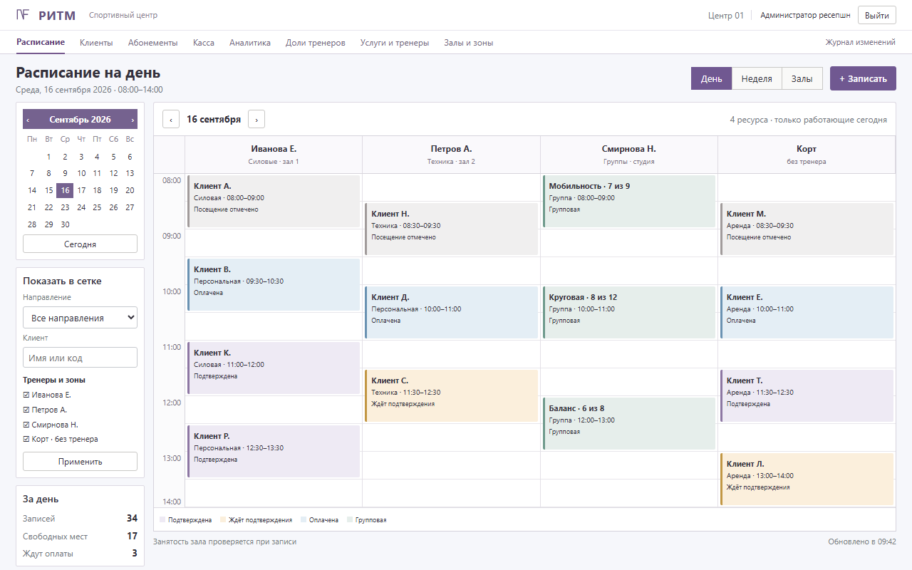

# Портфолио — CRM и учётные системы для бизнеса

Разрабатываю CRM и учётные системы под ключ: расписание и запись, клиенты, касса и расчёты, документы и отчёты, роли и права сотрудников. Веб-приложения и настольные программы, перенос данных из таблиц и старых систем, развёртывание и сопровождение.

---

## Флагманский кейс: CRM для сервисной компании

**[CRM для спортивного центра](кейсы/02-crm-спортцентра/README.md)** — единая система вместо таблиц, тетрадей и отдельного Excel для кассы. Сейчас в эксплуатации, доработки идут по отзывам сотрудников.

- **Расписание** специалистов и помещений с проверкой занятости, запись на услуги из прайса.
- **Касса и финансы:** счета, скидки, автоматический расчёт долей сотрудников, отчёт о задолженности.
- **Аналитика для руководства** с конструктором отчётов и выгрузкой в Excel.
- **Роли и безопасность:** свои права для каждой роли, двухфакторная аутентификация, журнал изменений.
- **Перенос данных:** десятки таблиц и сотни тысяч строк с SQLite на PostgreSQL со сверкой значений.
- **Скорость и качество:** ключевые страницы за десятки миллисекунд, 250+ автотестов, резервная копия перед каждым обновлением.

Django · PostgreSQL · Docker · Caddy

## Другие коммерческие кейсы (под NDA, обезличены)

| Кейс | Суть | Стек | Цифры |
|---|---|---|---|
| [Учётная система для сети лабораторий](кейсы/01-экспертные-заключения/README.md) | Оформление документов по бланкам, сквозная нумерация, реестр, смены, отчёты, офлайн-рабочие места в филиалах | Python, PostgreSQL, Docker, Nginx (mTLS) | 400+ сквозных сценариев перед каждым выпуском |
| [Учёт и контроль на упаковочных линиях](кейсы/03-контроль-упаковочных-линий/README.md) | Рабочие места операторов, акты и их печать, реестр, журнал и сводка по линиям, работа без сети | Python, PyQt5, SQLite | 5 программ |
| [Оповещения на сортировочном терминале](кейсы/04-оповещение-сортировочного-терминала/README.md) | Сервер, панель диспетчера и клиенты участков: оповещения с подтверждением, аудит | FastAPI, WebSocket, Electron | доставка после обрыва связи |
| [Автопроверка записей в учётной системе](кейсы/05-нейросети-на-офисных-пк/README.md) | Программа проверяет и исправляет записи вместо оператора | Python, OpenCV | 99,3 % решений за смену |

## Как я работаю

1. **Разбор задачи и оценка — бесплатно.** Задаю вопросы, предлагаю решение и план из этапов со сроками и стоимостью каждого.
2. **Договор и NDA** — по вашему запросу.
3. **Оплата: 50 % / 25 % / 25 %.** 50 % — старт работ, 25 % — после демонстрации промежуточного результата, который можно проверить самому, 25 % — после сдачи и приёмки.
4. **Прозрачный ход работ.** Показываю рабочую версию каждые несколько дней, а не только в конце.
5. **Сдача под ключ:** исходный код и права на него, развёртывание на вашем сервере, инструкции для пользователей и администратора.
6. **Гарантия 30 дней** после приёмки: ошибки исправляю бесплатно. Дальше — поддержка и доработки по договорённости.

Код пишу в паре с ИИ-агентами (OpenAI Codex, Claude Code): постановка задачи, архитектура, проверка результата, развёртывание и общение с заказчиком — на мне.

## Навыки
- **CRM и учётные системы:** расписание и запись, клиентская база, касса и расчёты, роли и права, отчёты и аналитика, импорт из Excel, перенос данных
- **Бэкенд и веб:** Django, FastAPI, WSGI, Jinja2, PostgreSQL, SQLite, REST, WebSocket
- **Документы:** генерация DOCX/PDF/XLSX по шаблонам, печать по бланкам
- **Безопасность:** роли и права, 2FA (TOTP), X.509/mTLS, журналы аудита, вынос секретов из кода
- **Инфраструктура:** Docker Compose, Nginx (mTLS), Caddy, Gunicorn, Let's Encrypt, резервное копирование и откат, работа в закрытом контуре
- **Десктоп:** PyQt5, WinForms, Electron, tkinter, сборка в один exe (PyInstaller)
- **Качество:** автотесты (pytest, unittest), smoke-проверки после релиза, инструкции для пользователей
- **Языки:** Python, C#, JavaScript, SQL, PowerShell
- Также: компьютерное зрение и локальные нейросети (OpenCV, YOLOv8, ONNX)

## Открытый проект

| Проект | Описание | Стек |
|---|---|---|
| [Антиспам-бот для Telegram](github/telegram-antispam-bot/README.md) | Объяснимый фильтр спама на взвешенных правилах, 19 тестов | Python, Bot API |

---

Дополнительно: решения с локальными нейросетями

| Решение | Суть |
|---|---|
| [Локальный ассистент по документам компании](решения/01-локальный-ии-ассистент/README.md) | Ответы по договорам и регламентам со ссылками на источник, без внешних нейросетей. [MVP с открытым кодом](https://github.com/turnkey-dev/local-doc-assistant) |
| [Оператор для программ без API](решения/02-ии-оператор-для-программ-без-api/README.md) | Перенос и сверка данных в старых учётных программах через экран и клавиатуру |

