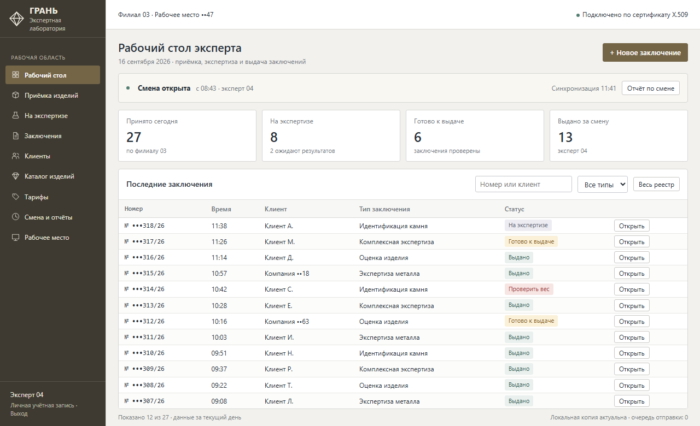
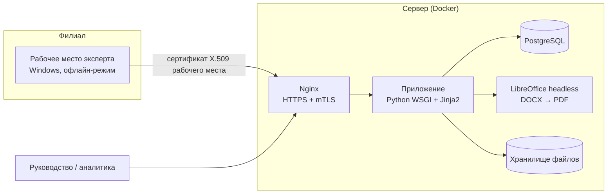
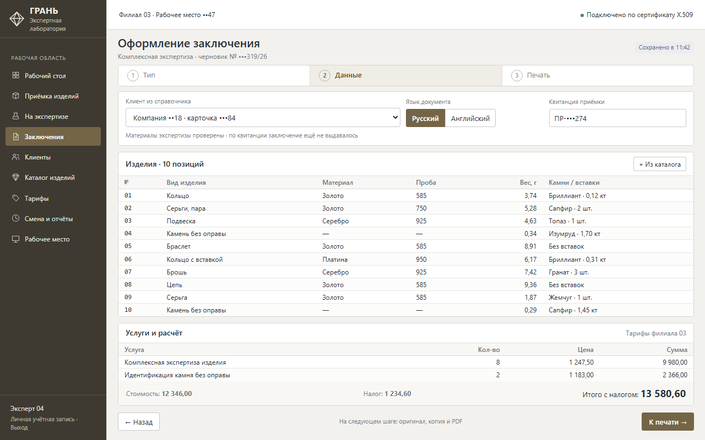

# Кейс: система оформления экспертных заключений для сети лабораторий

> Коммерческий проект под NDA. Заказчик, его клиенты и данные не раскрываются. Скриншоты — макеты на вымышленных данных; оформление намеренно отличается от реальной системы.

**Заказчик:** сеть лабораторий экспертизы и оценки ювелирных изделий и драгоценных камней. Филиалы находятся в разных городах, у части из них слабый интернет.
**Роль:** полный цикл, от разбора ТЗ до развёртывания на сервере. Код писался в паре с ИИ-агентами (Codex, Claude Code). Архитектура, приёмка и внедрение — мои.
**Срок:** 2026 год. Проект выходил серией проверенных выпусков с возможностью отката.

## Задача
Эксперты оформляли заключения вручную в Word: номера сбивались, копии терялись, отчёты собирались по бумажкам. Заключение — документ строгой отчётности, поэтому нужно было:
- оформлять документы нескольких типов по утверждённым бланкам, в том числе на английском языке для иностранных клиентов;
- вести сквозную нумерацию, реестр выданных заключений, смены и отчёты;
- разграничить права экспертов, руководителей филиалов и администраторов;
- работать в филиалах со слабым интернетом и без него.

## Решение

- **Мастер оформления из трёх шагов** (тип заключения → данные → печать) со справочниками клиентов и видов изделий. Строки услуг и итоговая сумма с налогом считаются автоматически.
- **Генерация документов** по шаблонам DOCX: оригинал и копия печатаются одной кнопкой, PDF собирается через LibreOffice headless.
- **Доступ только с зарегистрированных рабочих мест** по сертификату X.509 (mTLS в Nginx). Филиал определяется автоматически.
- **Офлайн-комплект для Windows.** Эксперт скачивает его из личного кабинета, целостность каждого файла проверяется по SHA-256.
- **Процесс экспертизы:** приёмка изделия → экспертиза → результаты → выдача заключения. Второе заключение по той же квитанции приёмки выдать нельзя.
- **Безопасность:** роли с гибким набором прав, двухфакторная аутентификация, неизменяемый журнал аудита, приложение работает под ограниченной ролью БД, контейнер без root.
- **Резервное копирование:** согласованный дамп базы и архив файлов с манифестом контрольных сумм; проверка и восстановление одной командой.
- **Отчёты XLSX/PDF** и дашборд по филиалам и экспертам.

## Качество
- **Более 400 сквозных сценариев** на изолированной базе перед каждым выпуском, включая запреты прав, восстановление из копии и сверку хешей.
- Регрессионные тесты вёрстки: бланки печатаются точно по бумажному образцу.
- Выпуски неизменяемы: у каждого свой идентификатор образа и контрольная сумма, откат — на сохранённую точку.

## Результат
- Нумерация, реестр, печать оригинала с копией и отчёты ведутся автоматически, без ручного Word.
- Рабочие места в филиалах ставятся из офлайн-комплекта без участия разработчика.
- Для экспертов подготовлено руководство пользователя.

## Стек
Python (WSGI на стандартной библиотеке, минимум внешних зависимостей), Jinja2, python-docx, openpyxl, reportlab · PostgreSQL / SQLite для разработки · LibreOffice headless · Docker Compose, Nginx (mTLS), Let's Encrypt · PowerShell для установщика рабочего места.
