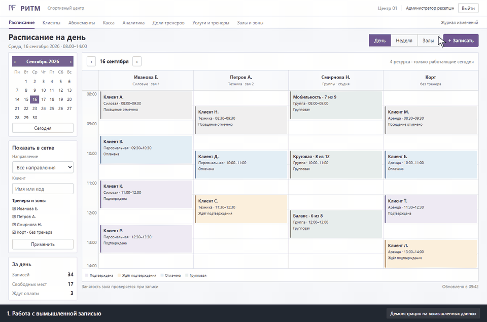
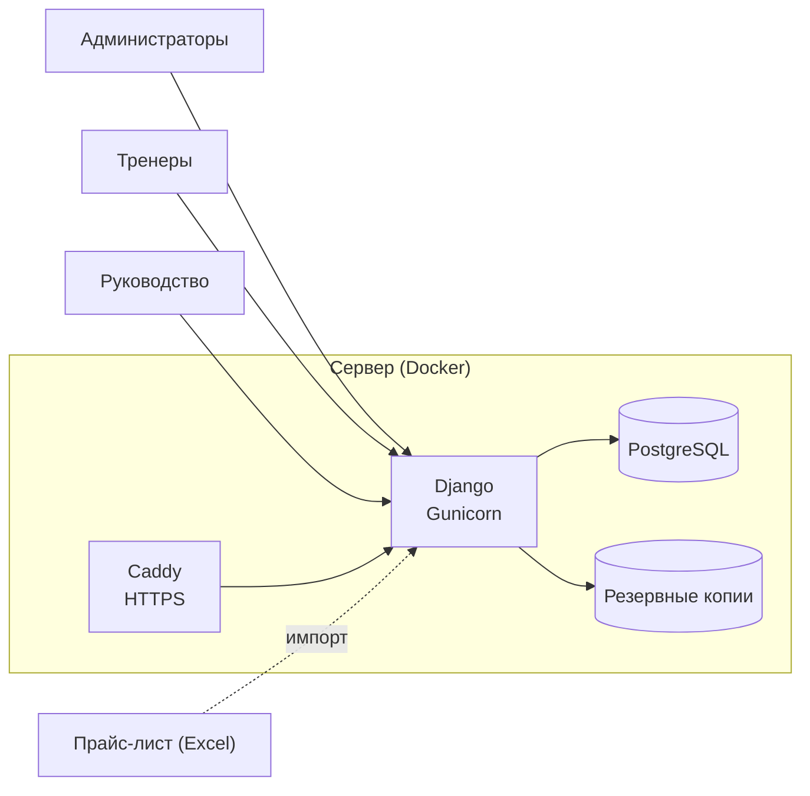
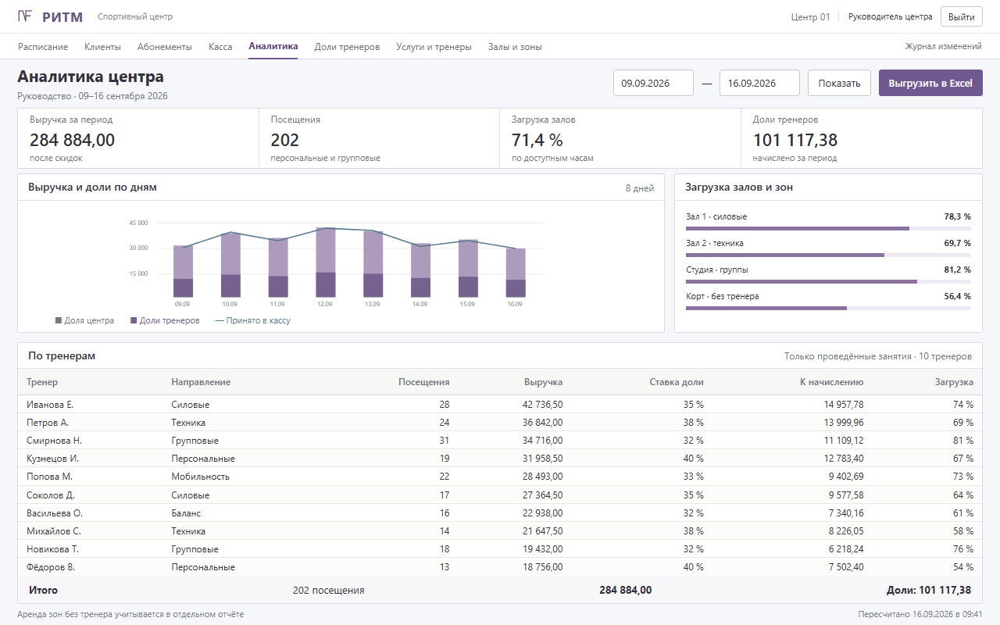

# Кейс: CRM для спортивного центра

> Коммерческий проект под NDA. Заказчик, сотрудники и данные не раскрываются. Скриншоты — макеты на вымышленных данных; оформление намеренно отличается от реальной системы.

**Заказчик:** спортивный центр с персональными и групповыми тренировками, залами с оборудованием и собственной кассой.
**Роль:** разработка, перенос данных, развёртывание и сопровождение. Код писался в паре с ИИ-агентами (Codex, Claude Code). Требования, приёмка и работа с персоналом — мои.
**Срок:** 2026 год, сейчас идёт эксплуатация и доработки по отзывам сотрудников.

## Задача
Запись велась в таблицах и тетрадях, касса — в отдельном Excel, доли тренеров считались вручную. Нужна была единая система:
- расписание тренеров и залов с проверкой занятости;
- карточки клиентов, отметки о посещениях и результатах тренировок;
- касса, скидки, доли тренеров, аналитика для руководства;
- свои права для каждой роли персонала.

## Решение

- **Расписание** по дням, неделям и месяцам, сетка тренеров и залов. Занятость проверяется при записи, один зал нельзя занять дважды.
- **Матрица «направление → услуга → тренер»** импортируется из Excel-прайса: при записи показываются только те, кто ведёт выбранную услугу.
- **Залы и зоны без тренера** (аренда корта, свободное посещение тренажёрного зала) бронируются отдельно, отметку о посещении ставит администратор.
- **Финансы:** счета, касса, скидки, автоматическое распределение долей тренеров, отчёт о задолженности.
- **Аналитика для руководства** с конструктором отчётов и выгрузкой.
- **Безопасность:** личные учётные записи, двухфакторная аутентификация (TOTP) с резервными кодами, журнал изменений учётных данных, контакты клиентов скрыты от ролей, которым они не нужны.

## Перенос данных и производительность
- Рабочая база переехала с SQLite на PostgreSQL со сверкой значений: несколько десятков таблиц и сотни тысяч строк.
- По итогам аудита производительности ключевые страницы формируются за десятки миллисекунд, а самая тяжёлая — сетка залов — быстрее 0,2 секунды. Увеличивать сервер не понадобилось.

## Качество
- **Более 250 автотестов** (права ролей, 2FA, CSRF), после каждого релиза — smoke-проверка всех ролей.
- Перед каждым обновлением делается резервная копия кода и базы, откат проверен.
- Для каждой роли написаны руководства со скриншотами.

## Стек
Python, Django, django-otp · PostgreSQL · Gunicorn, Caddy, Docker Compose · openpyxl · HTML/CSS/JS.
