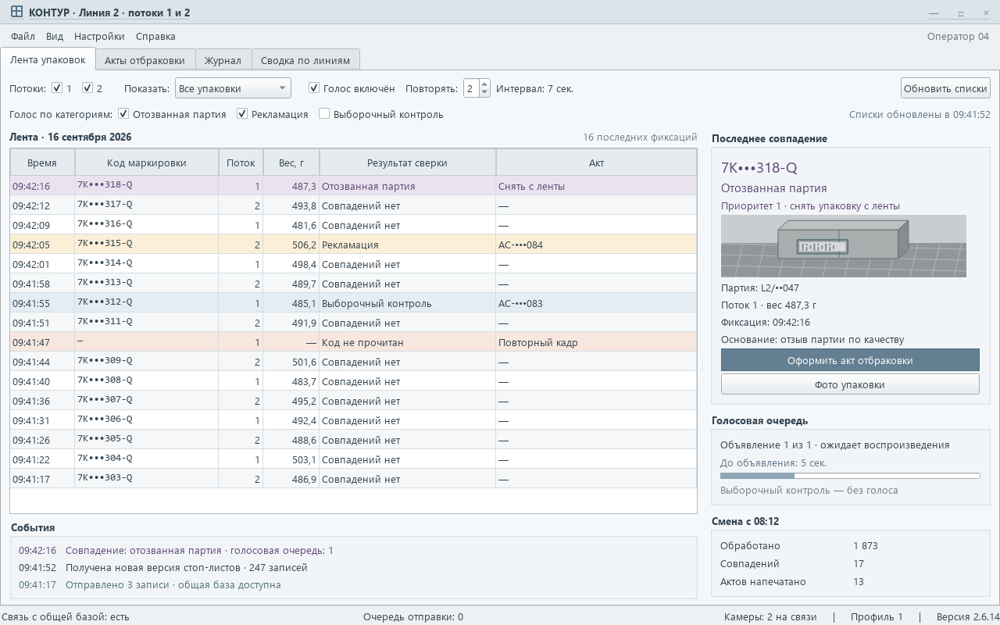
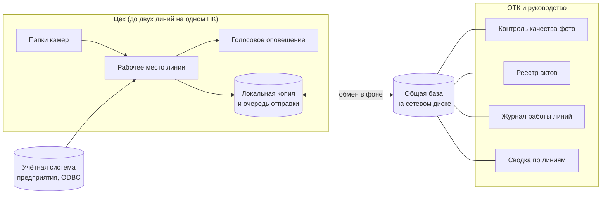
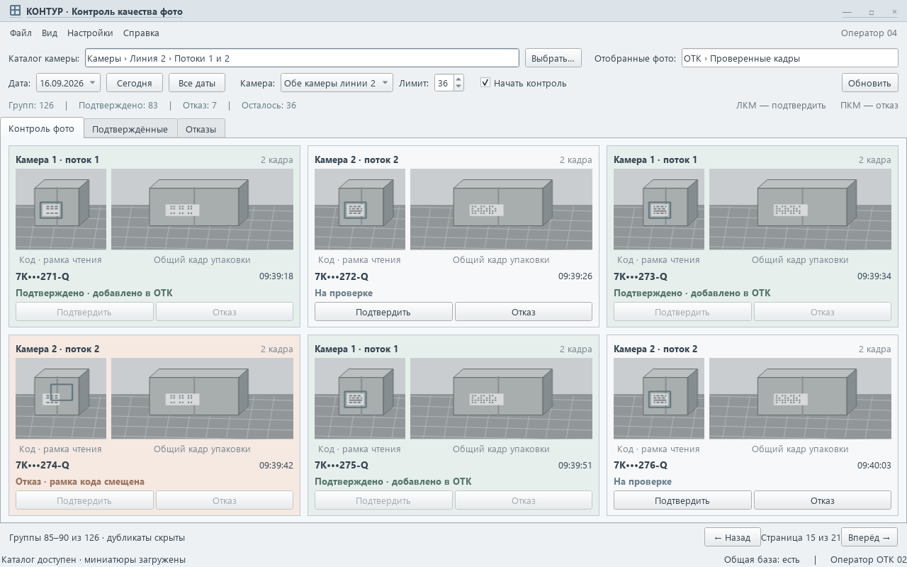

# Кейс: рабочие места контроля на упаковочных линиях

> Коммерческий проект под NDA. Заказчик, продукция, оборудование, внешние системы и данные не раскрываются. Скриншоты — макеты на вымышленных данных; оформление намеренно отличается от реальной системы.

**Заказчик:** производственное предприятие с несколькими упаковочными линиями. Над каждой линией стоят камеры, которые снимают упаковку и считывают код маркировки.
**Роль:** полный цикл, от разбора задачи с операторами до сборки и внедрения на линиях. Код писался в паре с ИИ-агентами (Codex, Claude Code). Архитектура, приёмка и работа с персоналом — мои.
**Срок:** 2026 год, эксплуатация и доработки по замечаниям смен.

## Задача
Камеры складывали снимки каждой упаковки в сетевые папки, а дальше всё делалось вручную: оператор листал фотографии, сверял коды с несколькими стоп-листами (отозванные партии, рекламации, выборочный контроль), оформлял акты и вёл учёт в таблицах. Нужно было:
- в реальном времени сверять каждую упаковку со стоп-листами разного приоритета и сразу оповещать оператора;
- отбирать фотоматериалы и оформлять по ним акты отбраковки для печати;
- собирать журнал, реестр актов и статистику всех линий в одном месте;
- работать на обычных компьютерах в цехе с нестабильной сетью.

## Решение

Комплекс из **пяти настольных программ** и общей базы:

- **Рабочее место линии.** Следит за папками камер, сверяет код маркировки со стоп-листами разного приоритета из учётной системы, подсвечивает совпадение и объявляет его голосом, чтобы оператор снял упаковку с конвейера. Отключённая категория молчит, но всё равно попадает в журнал.
- **Оформление актов.** Карточка упаковки с просмотром фото (масштаб, полный экран), форма акта отбраковки и печать на A4. В базу запись попадает только после фактической отправки на печать, отменённая печать ничего не оставляет.
- **Контроль качества фото.** Каталог снимков группирует кадры одной упаковки в одну карточку и скрывает дубликаты. Подтверждение и отказ — одним щелчком мыши, миниатюры грузятся в фоне, поэтому интерфейс не подвисает даже на медленном сетевом диске.
- **Реестр актов, журнал работы линий и сводка** по линиям, потокам конвейера и периодам. Фильтры и ширины колонок запоминаются.
- **Централизованная настройка линий:** камеры, потоки и тексты объявлений задаются в админке и сами раздаются на рабочие места.

## Инженерные решения
- **Работа без сети.** Рабочее место пишет в локальную копию и копит очередь. Если общая база недоступна, программа ждёт и не создаёт пустой файл на её месте. Связь вернулась — очередь уходит в фоне.
- **Две линии на одном компьютере.** Каждый экземпляр занимает свой профиль со своими базами (SQLite в режиме WAL), окна сами встают слева и справа.
- **Надёжная озвучка.** Одна очередь с приоритетами, межпроцессная блокировка, чтобы два экземпляра не говорили одновременно. Каждая фраза произносится в отдельном процессе: если голосовой движок зависнет, сорвётся только одна попытка, и она повторится.
- **Без лавины при старте.** При подключении папки делается снимок уже лежащих файлов, объявляется только новое, включая файлы, скопированные со старой датой.
- **Учётные записи** с хранением отпечатков паролей, журнал действий администраторов (закрытие актов, удаление, очистка).

## Качество и поставка
- Пять программ собираются в отдельные exe одной командой. Сборка не обрывается на первой ошибке: у каждой программы свой журнал и итоговая сводка.
- Перед сборкой автоматически проверяются служебные скрипты (кодировка и переводы строк), чтобы сборка не ломалась на ровном месте.
- Правила проекта и карта модулей вынесены в отдельную памятку, по которой любую задачу можно найти за минуту.

## Результат
- Сверка упаковок и оповещение идут автоматически, оператор реагирует только на совпадения.
- Акты оформляются и печатаются из программы, учёт по всем линиям собирается в одном месте.
- Обрывы сети в цехе больше не приводят к потере записей.

## Стек
Python, PyQt5 · SQLite (WAL, работа на сетевом диске) · ODBC для учётной системы · reportlab (PDF) · голосовой движок Windows · PyInstaller.
