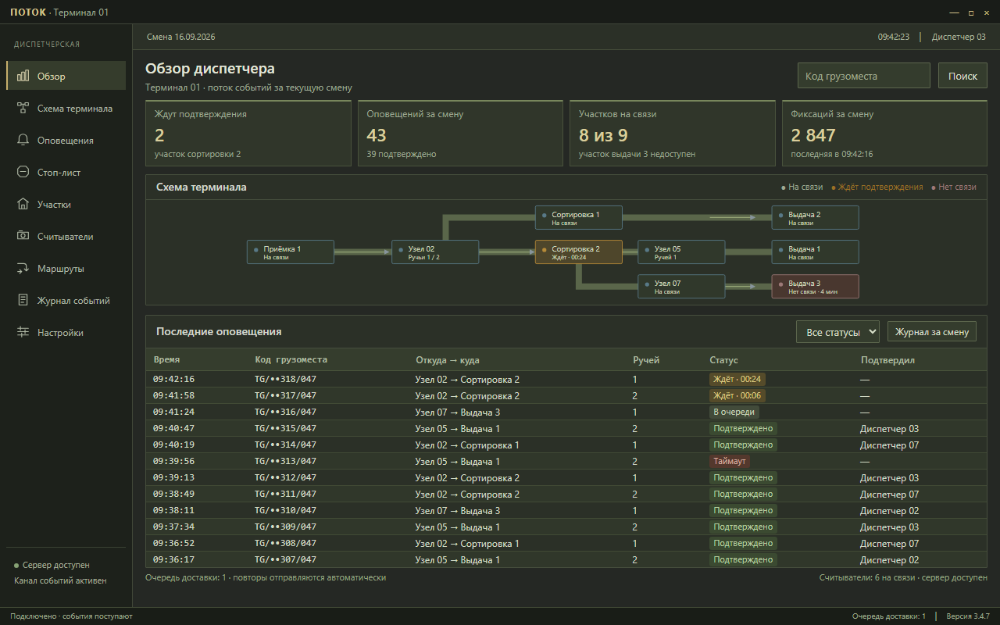
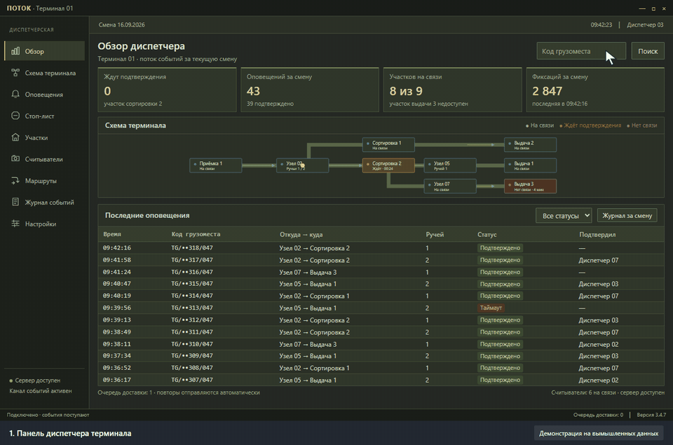
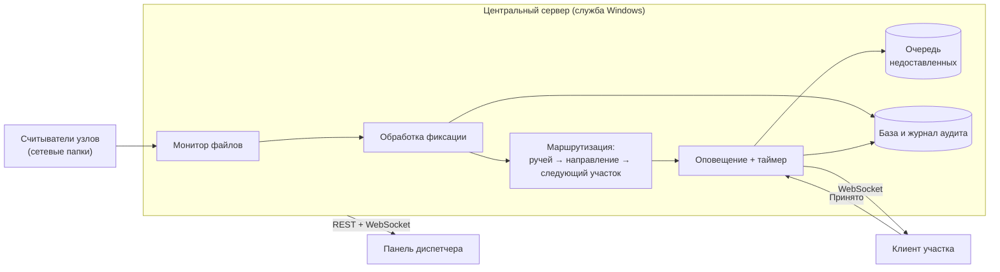
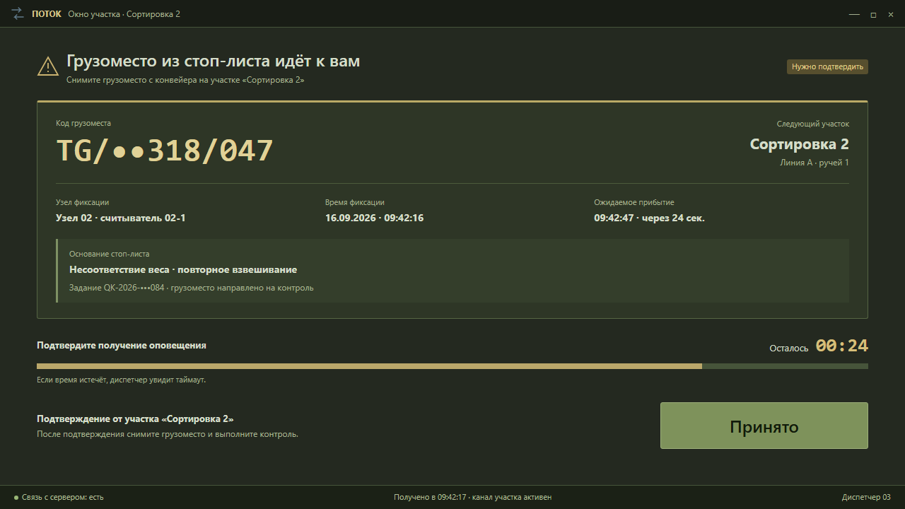

# Кейс: межучастковое оповещение на сортировочном терминале

> Коммерческий проект под NDA. Заказчик, оборудование и данные не раскрываются. Скриншоты — макеты на вымышленных данных; оформление намеренно отличается от реальной системы.

**Заказчик:** логистический оператор с сортировочным терминалом. На узлах конвейера стоят камеры-считыватели, которые фотографируют грузовые места и читают их коды.
**Роль:** проектирование и разработка всех трёх компонентов, документация. Код писался в паре с ИИ-агентами (Codex, Claude Code). Архитектура и приёмка — мои.
**Срок:** 2026 год.

## Задача
Участки терминала работали независимо друг от друга: если грузоместо из стоп-листа проходило один узел, следующий участок узнавал об этом поздно или не узнавал вовсе, и груз уезжал дальше по маршруту. Нужно было:
- автоматически замечать грузоместа из стоп-листа по фиксациям считывателей;
- предупреждать именно тот участок, к которому груз едет, а не всех подряд;
- требовать от участка подтверждения и видеть, кто не ответил;
- не терять оповещения при обрывах связи.

## Решение

- **Центральный сервер** круглосуточно следит за папками считывателей, разбирает каждую фиксацию и сверяет код грузоместа со стоп-листом.
- **Маршрутизация.** По считывателю и ручью конвейера определяется направление движения, по схеме терминала — ближайший участок по ходу. Оповещение уходит только туда.
- **Подтверждение обязательно.** На участке всплывает окно с кнопкой «Принято» и обратным отсчётом. Не подтвердили вовремя — диспетчер видит таймаут.
- **Устойчивость к обрывам.** Если участок не на связи, оповещение ждёт в очереди и доставляется при переподключении.
- **Панель диспетчера:** обзор и схема терминала, оповещения со статусами, грузоместа в стоп-листе, участки, считыватели и их ручьи, маршруты, поиск, статистика и полный журнал аудита.

## Инженерные решения
- Асинхронный сервер: приём файлов, обработка и рассылка не блокируют друг друга.
- Двусторонняя связь с участками и панелью через WebSocket, отдельные каналы для участков и диспетчеров.
- Каждое событие — фиксация, оповещение, подтверждение, таймаут, сбой считывателя — пишется в журнал аудита.
- Настройки (интервалы, таймауты, исключения для нечитаемых кодов) вынесены в конфигурационный файл, сервер ставится как служба Windows.
- Документация для трёх ролей: руководство пользователя, руководство администратора и техническое описание с API.

## Стек
Python, FastAPI, SQLAlchemy (async), WebSocket, watchdog · Electron (панель диспетчера и клиент участка) · SQLite · служба Windows через NSSM.
