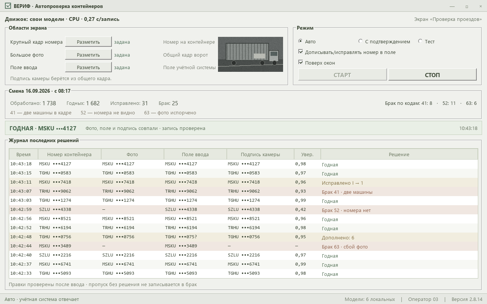
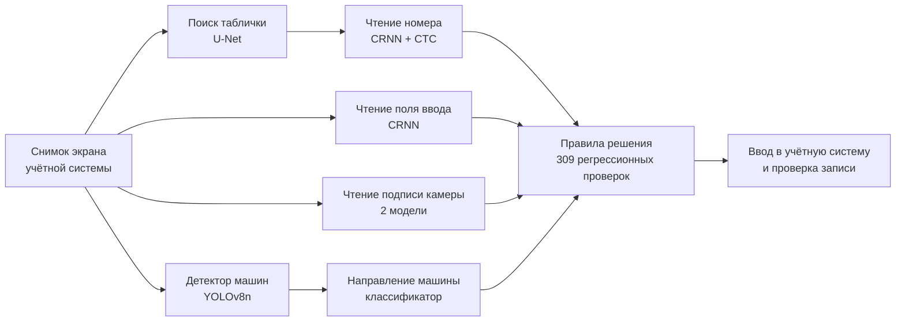
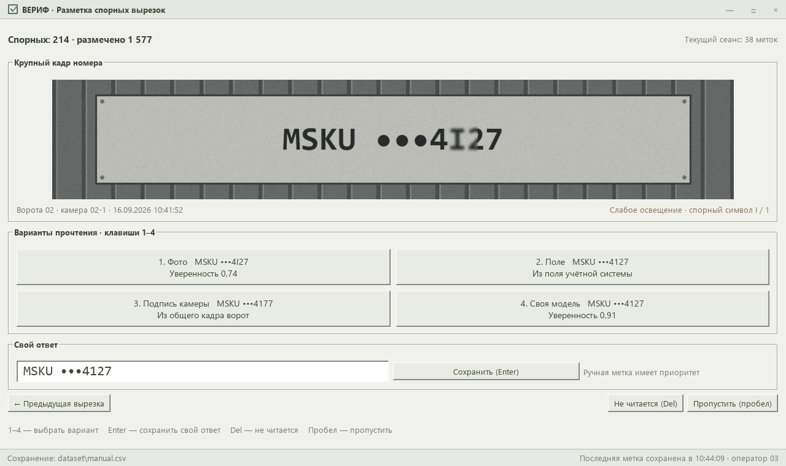

# Кейс: свои нейросети для автопроверки фотофиксаций на обычных офисных ПК

> Коммерческий проект под NDA. Заказчик, оборудование, учётная система и данные не раскрываются. Скриншоты — макеты на вымышленных данных; оформление намеренно отличается от реальной системы.

**Заказчик:** контейнерный терминал. Камеры на въездных воротах снимают каждый грузовик, распознают номер контейнера, и запись попадает в учётную систему. Там оператор вручную проверяет каждую запись: исправляет неверно прочитанный номер или бракует запись с кодом причины.
**Роль:** весь цикл — от постановки задачи до сбора датасета, обучения моделей, правил решения и внедрения на рабочем месте оператора. Код писался в паре с ИИ-агентами (Codex, Claude Code). Выбор подхода, разметка спорных случаев, проверка качества и работа с заказчиком — мои.
**Срок:** 2026 год, программа работает в сменах и дообучается на новых данных.

## Задача
За смену приходят тысячи записей, работа однообразная и выматывающая. Нужна была программа, которая:
- смотрит на экран учётной системы, читает номер на фото и в поле ввода;
- принимает то же решение, что внимательный оператор: «годная», «исправить номер» или «брак с кодом» (номера не видно, в кадре две машины, фото испорчено, нестандартный формат, служебная техника, несовпадение);
- сама нажимает нужные клавиши и проверяет, что исправление записалось;
- работает **без интернета и облачных API** и, в итоге, **без видеокарты**, на обычном офисном компьютере.

## Путь к решению

| Поколение | Подход | Итог |
|---|---|---|
| 1 | Классический OCR и жёсткие координаты | Не справлялся с ночными и смазанными кадрами |
| 2 | Мультимодальная LLM смотрит на экран и решает всё сама | Выдумывала номера, 5–20 с на кадр |
| 3 | Детектор + специализированная OCR-модель на GPU + явные правила | ~1 с на кадр, **99,3 %** решений совпало с фактом за смену из 8 тыс. записей |
| 4 | **Свои компактные модели вместо тяжёлой OCR**, только процессор | 0,26 с на запись, решения совпадают с GPU-версией в **99 %** случаев (тестовая версия, контрольная выборка 200 записей) |

Главный принцип: **нейросети только видят, решения принимает код.** Правила проверяются тестами и объясняются по журналу, а ошибки моделей ловятся защитами.

## Модели

Все модели экспортированы в ONNX и выполняются через onnxruntime на процессоре. Вместе они весят около 11 МБ без учёта детектора.

| Модель | Архитектура | Размер | Данные | Результат |
|---|---|---|---|---|
| Чтение номера | CRNN: свёртки + BiLSTM + CTC, вход 32×160 | 4,4 МБ | 14 тыс. вырезок, 5,9 тыс. разных номеров | **94,5 %** знак в знак на номерах, которых не было в обучении; при уверенности ≥ 0,9 — 98 %. По основной части номера — 96 % против 87 % у готовой OCR-модели на тех же вырезках |
| Поиск таблички на кадре | U-Net | 1,3 МБ, 28 мс | 6,9 тыс. автоматически размеченных пар + 2,4 тыс. кадров без номера | Попадание (IoU ≥ 0,5) 91–97 % против 6 % у прежнего алгоритма |
| Направление машины | Свёрточный классификатор | 0,4 МБ | 2,1 тыс. машин из одной смены | 97,7 %. Нужна для правила «две машины»: без направления около 50 из 248 таких браков за смену были ложными |
| Чтение поля ввода | CRNN | 1,3 МБ | Снимки поля из журналов | Совпадение с GPU-версией 98,5 % |
| Подпись камеры (2 вида) | CRNN | 2 × 1,7 МБ | Снимки подписей из журналов | Совпадение с GPU-версией 98,5 % |
| Детектор машин | YOLOv8n (готовые веса) | 12 МБ | — | Поиск машин для правила «две машины в кадре» |

## Датасет и обучение
- **Сбор без ручного труда.** Программа сохраняет каждую вырезку номера (~6 КБ). Если номер одинаково прочитали три независимых источника (фото, поле и подпись камеры), метка ставится автоматически. Если источники разошлись, вырезка уходит в разметку.
- **Своя утилита разметки:** крупная вырезка, варианты прочтения кнопками, клавиши 1–9, «не читается». Ручная метка главнее автоматической. Автометки проверяются по подозрительным шаблонам и случайной выборке.
- **Разметка для детектора — из данных:** положение таблички на большом кадре найдено шаблонным поиском по уже имеющейся крупной вырезке.
- **Честная проверка.** Номера на терминале повторяются каждый день, поэтому контрольная выборка состоит из номеров, которых **не было в обучении**, иначе точность была бы завышена.
- **Редкие классы** (нестандартные форматы) показываются при обучении в 2–6 раз чаще.
- **Обучение на процессоре** (TensorFlow CPU), экспорт в ONNX. Несколько итераций дообучения по мере роста датасета, прежние версии моделей сохраняются для отката.
- **Внедрение «в тени».** Новая модель сначала только пишет свои прочтения в журнал рядом с рабочей. Переключение — когда она надёжно лучше на отложенной выборке.

## Защиты от ошибок распознавания
Модели ошибаются, и ошибаются уверенно. Большая часть кода правил — защиты, и каждая появилась после конкретного случая из журнала:
- **чёрный список «выдумок»:** строка, которую модель выдала на трёх разных фото, запоминается как галлюцинация;
- пустые картинки модели не показываются;
- позиционная починка похожих символов (O/0, B/8) с запретами, чтобы починка не сочиняла номера;
- сверка с «свидетелями» — полем ввода и подписью камеры;
- **сторож зависания:** если окно учётной системы застыло (отпечаток снимка не меняется), нажатия приостанавливаются;
- принцип «лучше пропустить, чем забраковать»: ложный брак хуже ложного пропуска.

Все случаи собраны в **309 регрессионных проверок**: правка правила, которая ломает старый случай, видна сразу.

## Результат
- Программа обрабатывает смену за оператора: за смену из 8 тыс. записей **99,3 %** решений совпало с фактом после ручной сверки.
- Версия на своих моделях не требует видеокарты и тяжёлого сервера модели: **0,26 с на запись на процессоре**.
- Каждое решение объяснимо: подробный журнал по кадру, история решений со снимками, разбор последних кадров по областям экрана.

## Стек
Python · TensorFlow (обучение), ONNX, onnxruntime · YOLOv8n · CRNN + CTC, U-Net · OpenCV, numpy, Pillow · llama.cpp / LM Studio (GPU-версия) · tkinter · WinAPI через ctypes (SendInput, поиск окон) · pyautogui.
