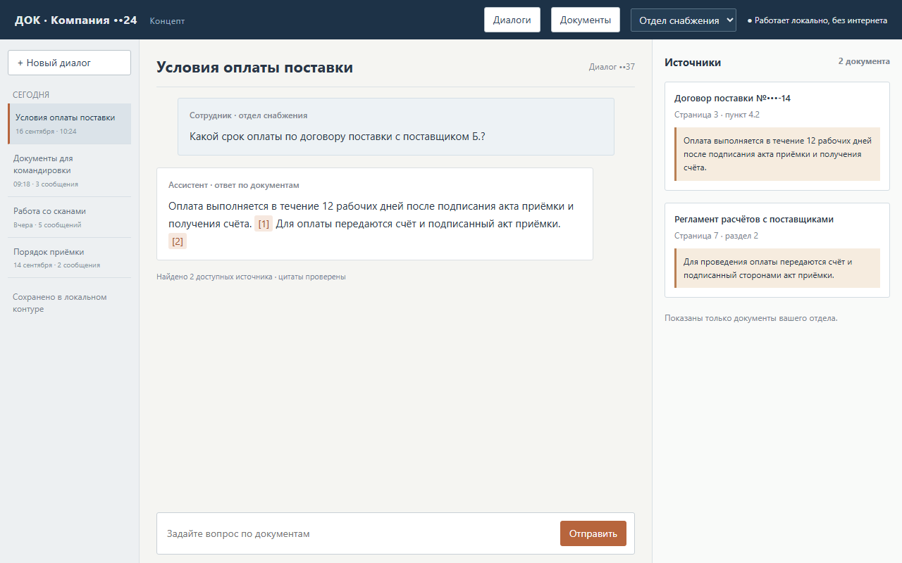
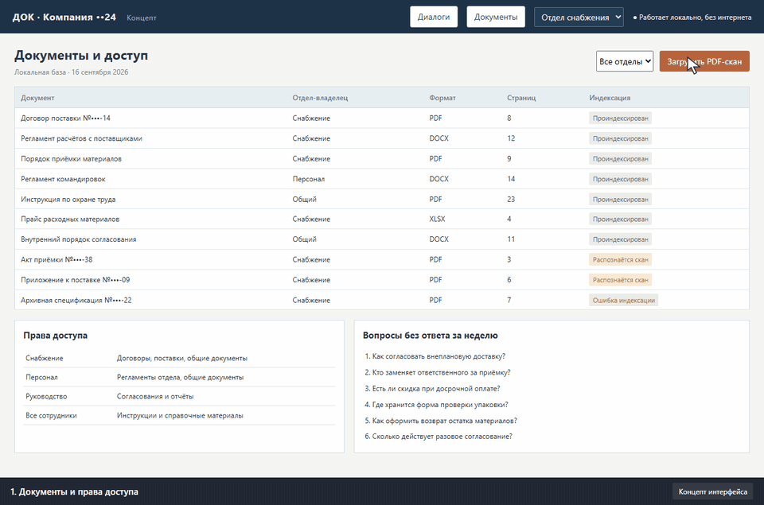
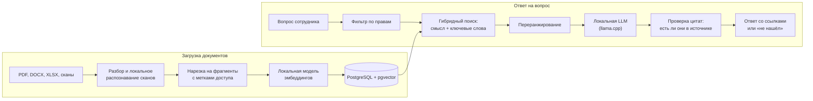
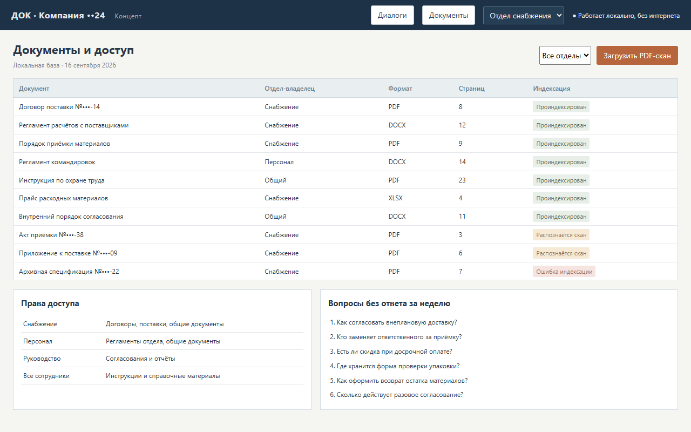

# Решение: локальный ИИ-ассистент по документам компании

> Решение, которое я внедряю под задачи заказчика. Интерфейс на скриншотах и в демо — концепт на вымышленных документах. Подходы к безопасности, офлайн-работе и защите от ошибок нейросетей взяты из реальных проектов: [кейс 1](../../кейсы/01-экспертные-заключения/README.md) и [кейс 5](../../кейсы/05-нейросети-на-офисных-пк/README.md).

## Какую задачу решает
Сотрудники тратят часы на поиск ответов в договорах, регламентах, инструкциях и переписке. Готовые чат-боты на внешних нейросетях не подходят: документы нельзя отправлять за пределы компании.

Ассистент отвечает на вопросы обычным языком **по вашим документам** и **работает внутри компании**, на офисном сервере, без интернета.

## Что получает заказчик
- **Ответ с источниками.** Каждый ответ подкреплён цитатами со ссылкой на документ и страницу. Щелчок по цитате открывает нужное место.
- **«Не нашёл» вместо выдумки.** Если в документах ответа нет, ассистент так и говорит, а не сочиняет.
- **Права доступа.** Бухгалтерия не видит документы отдела кадров, сотрудник — документы руководства. Фильтр стоит до поиска, поэтому закрытый документ не может попасть в ответ.
- **Любые форматы:** PDF, DOCX, XLSX, сканы. Сканы распознаются локально.
- **Журнал запросов** для руководителя: что спрашивают, где ассистент не нашёл ответа и каких документов не хватает.
- **Веб-интерфейс и Telegram-бот** внутри корпоративного контура.
- **Установка одной командой** (Docker Compose), резервное копирование и откат.

## Как устроено

- **Ответ строится только из найденных фрагментов.** Модель получает фрагменты и обязана ссылаться на них. Перед выдачей код проверяет, что каждая цитата действительно есть в документе. Тот же принцип, что в кейсе 5: нейросеть формулирует, код проверяет.
- **Гибридный поиск.** Смысловой поиск находит перефразированное, поиск по словам — номера договоров, артикулы, фамилии.
- **Железо под бюджет.** Небольшие модели работают на процессоре офисного сервера. Для больших объёмов и быстрых ответов хватит одной видеокарты на 12–16 ГБ.

## Как меряем качество до запуска
Вместе с заказчиком составляем **контрольный набор из 50–100 реальных вопросов** с правильными ответами. На нём считаем:
- долю верных ответов;
- долю ответов с правильной ссылкой на источник;
- долю честных «не нашёл» на вопросах, ответа на которые в документах нет.

Цифры фиксируются до запуска и после каждого изменения. Так заказчик видит качество, а не верит на слово.

## Этапы внедрения
1. **Пилот за 1–2 недели:** один отдел, 100–300 документов, контрольный набор вопросов.
2. **Отчёт по качеству** и решение о расширении.
3. **Подключение остальных отделов,** прав доступа и Telegram, обучение сотрудников, инструкция.

## Стек
Python, FastAPI · PostgreSQL + pgvector · локальные модели эмбеддингов и LLM через llama.cpp · локальное распознавание сканов · Docker Compose, Nginx (HTTPS, при необходимости mTLS) · Telegram Bot API.
