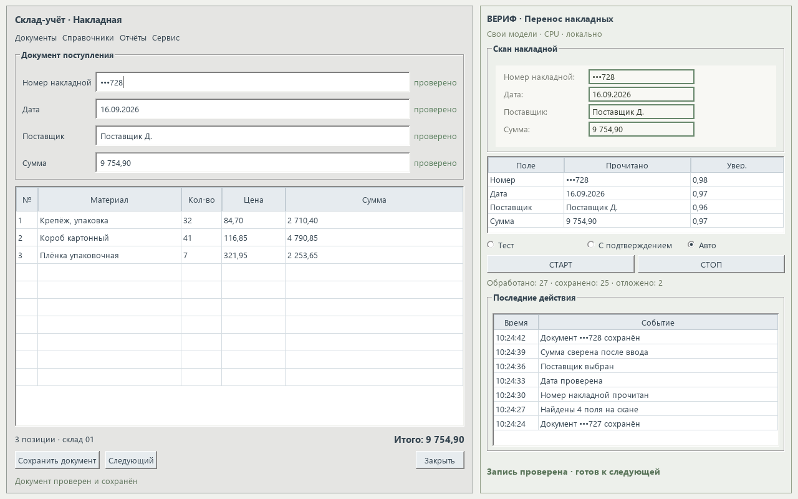
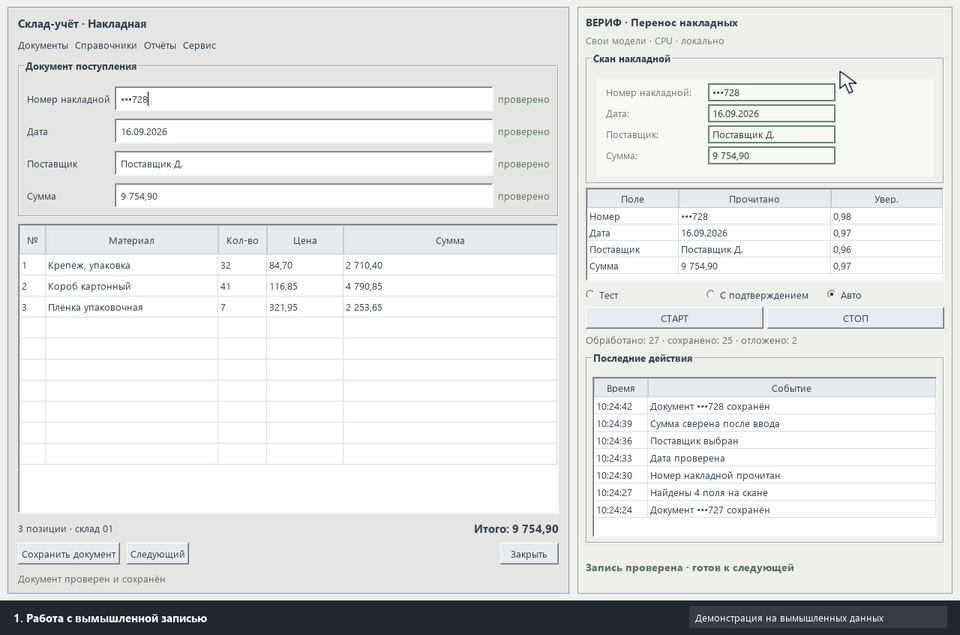
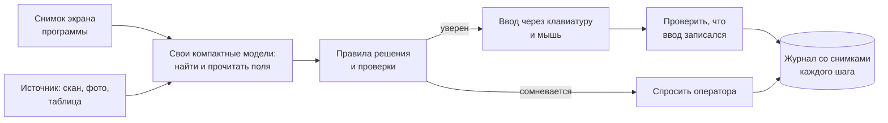
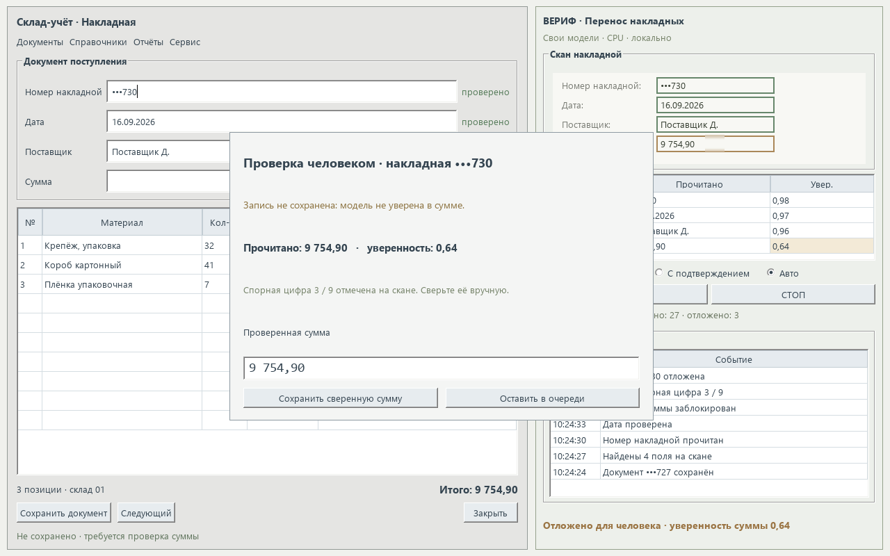

# Решение: ИИ-оператор для программ без API

> Решение, которое я внедряю под задачи заказчика. Подход проверен в реальном проекте — [кейс 5](../../кейсы/05-нейросети-на-офисных-пк/README.md): за смену из 8 тыс. записей 99,3 % решений программы совпало с фактом. Интерфейс на скриншотах и в демо — иллюстрация на вымышленной учётной программе.

## Какую задачу решает
Во многих компаниях ключевая работа идёт в старых учётных программах, у которых нет API: интеграцию не сделать, а переписывать систему дорого и долго. Поэтому операторы вручную переносят данные из сканов и таблиц, сверяют фото с записями, правят справочники — тысячами записей в смену.

ИИ-оператор делает эту работу **так же, как человек: через экран и клавиатуру**, но не устаёт, не отвлекается и ведёт подробный журнал.

## Где применяется
- Перенос данных из сканов, накладных и таблиц в учётную программу.
- Проверка фото-отчётов и записей: совпадает ли то, что на фото, с тем, что в поле.
- Массовая сверка и правка справочников.
- Любые повторяющиеся действия в программе, которую нельзя или дорого интегрировать.

## Как работает

- **Нейросети только видят, решения принимает код.** Правила проверяются тестами и объясняются по журналу.
- **Проверка после каждого действия.** Введённое значение считывается обратно и сравнивается с нужным. Не совпало — повтор, затем остановка с пометкой.
- **Сторож зависания.** Если окно программы перестало меняться, нажатия прекращаются, чтобы не вводить данные вслепую.
- **«Лучше пропустить, чем испортить».** В спорных случаях запись откладывается для человека, а не портится.
- **Три режима:** тест (только читает и пишет журнал, ничего не нажимает), с подтверждением каждого действия, автоматический.
- **Работает на обычном офисном ПК.** Свои модели весят единицы мегабайт и работают на процессоре, видеокарта и интернет не нужны.

## Как внедряем без риска для данных
1. **Тестовый режим на реальных записях:** программа только читает и предлагает решения, мы сравниваем их с решениями операторов.
2. **Режим с подтверждением:** оператор нажимает «да» на каждое действие, а мы собираем спорные случаи.
3. **Автоматический режим** — когда совпадение с операторами устойчиво высокое. Каждый разобранный спорный случай становится регрессионным тестом.

## Подтверждённые результаты подхода
Из [кейса 5](../../кейсы/05-нейросети-на-офисных-пк/README.md):
- **99,3 %** решений совпало с фактом за смену из 8 тыс. записей;
- **0,26 с** на запись на процессоре, без видеокарты (тестовая версия);
- **309** регрессионных проверок правил.

## Стек
Python · OpenCV · свои модели (CRNN, U-Net, классификаторы) через onnxruntime · WinAPI (SendInput, поиск окон) · журналирование со снимками экрана.
